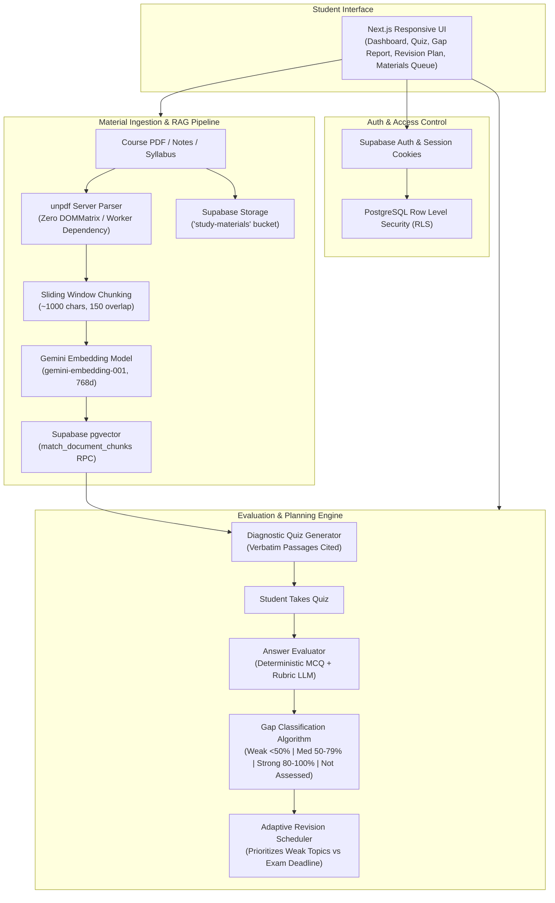

# GapFinder AI — Intelligent Learning Diagnosis & Adaptive Revision

> **"Find what you don't know before your exam does."**  
> An AI-powered educational diagnosis platform that ingests course syllabi, lecture notes, textbook chapters, and past question papers to pinpoint weak knowledge gaps and synthesize an adaptive, prioritized revision timetable.

---

## 1. Problem Statement

Students preparing for high-stakes university and competitive examinations frequently struggle with **illusion of competence** — passive rereading and superficial highlighters make them feel prepared, but they cannot identify their actual weak topics until they encounter them on the exam. 

Existing educational AI tools fall into two unhelpful extremes:
1. **Generic "Chat-with-PDF" bots** that only answer passive questions and frequently invent citations or hallucinations.
2. **Static flashcard apps** that require manual card creation and lack curriculum-level knowledge gap diagnostics or calendar-aware timetabling.

**GapFinder AI** bridges this gap: it serves as an **objective examiner**, diagnosing understanding through source-grounded diagnostic tests, scoring students against explicit rubrics, classifying topics into **Weak (0–49%)**, **Medium (50–79%)**, and **Strong (80–100%)**, and building an **adaptive daily revision plan** that recalculates as the student improves.

---

## 2. Key Capabilities & Architectural Pillars

| Feature | Description |
| :--- | :--- |
| **Multiple File Upload & Staging Queue** | Select multiple PDF, TXT, and Markdown files in one file-picker dialog. Supports queue appending without losing files, deduplication, per-file subject mapping, and resilient batch execution. |
| **Server-Side PDF Parsing (Zero DOMMatrix / Worker issues)** | Powered by `unpdf` in pure Node.js server runtimes. Correctly extracts page text without browser-only `DOMMatrix` or `.next/dev/server/chunks/pdf.worker.mjs` resolution errors. |
| **Subject & Document Categorization** | Create courses/subjects manually (e.g. *Operating Systems*, *Computer Networks*, *Data Structures*). Files map to 5 distinct categories: *Syllabus*, *Lecture Notes*, *Textbook / Chapter*, *Previous Question Paper*, and *Other Study Material*. |
| **Automated Curriculum Topic Mapping** | Analyzes syllabus structure to extract Subjects, Units, Topics, and Subtopics with weightage without hallucinating non-existent modules. |
| **Source-Grounded Diagnostic Quizzes** | Generates MCQs and short-answer questions strictly derived from retrieved textbook passages with exact citations. |
| **Dual Deterministic & Rubric Evaluation** | Deterministic answer matching for MCQs; criteria-based rubric scoring for short-answers with partial credit (0.0 to 1.0). |
| **Evidence-Based Knowledge Gap Analysis** | Classifies topic mastery with confidence levels based on attempt count, difficulty, and score consistency. Uses *Not Assessed* when evidence is insufficient. |
| **Adaptive Timetabling Engine** | Allocates 60-min deep-dives to weak topics, 45-min practice to medium topics, and 30-min spaced recall to strong topics, validating capacity against the exam deadline. |
| **Explain-This-Topic Assistant** | Grounded companion that cites exact uploaded passages and explicitly alerts students if their notes lack sufficient coverage. |
| **One-Click Demo Course Seeder** | Instant demonstration dataset (Operating Systems & System Architecture) for evaluators and judges. |

---

## 3. Technology Stack

- **Frontend & Routing**: [Next.js 16](https://nextjs.org/) (App Router, React 19, Turbopack, Server Components)
- **Language**: [TypeScript](https://www.typescriptlang.org/) with strict type checking
- **Styling**: [Tailwind CSS v4](https://tailwindcss.com/) with custom glassmorphism and dark mode design system
- **Database & Storage**: [Supabase](https://supabase.com/) PostgreSQL with Row Level Security (RLS) and Storage (`study-materials` bucket)
- **Vector Search**: PostgreSQL [pgvector](https://github.com/pgvector/pgvector) extension (`vector(768)`)
- **AI Models**: Google [Gemini API](https://ai.google.dev/) via `@google/genai`:
  - **Text Generation & Rubric Evaluation**: `gemini-3.8-flash`
  - **Semantic Embeddings**: `gemini-embedding-001` (768 dimensions)
- **PDF Extraction**: `unpdf` (isomorphic, workerless PDF.js build configured with Next.js `serverExternalPackages`)
- **Visual Analytics**: [Recharts](https://recharts.org/)
- **Icons**: [Lucide React](https://lucide.dev/)
- **Testing**: [Vitest](https://vitest.dev/) for automated unit & integration testing
- **Deployment**: [Vercel](https://vercel.com/)

---

## 4. Architecture Diagram



---

## 5. Database Schema

The database design is defined in version-controlled migrations under `supabase/migrations/`:

- **`profiles`**: User metadata, target examination name, target exam date, daily available study hours.
- **`subjects`**: Academic courses/subjects associated with the authenticated student (`name`, `code`, `description`, `exam_date`).
- **`documents`**: Uploaded syllabus, notes, textbook chapters, and past exam papers with `storage_path`, `file_type`, `total_pages`, `total_chunks`, and processing status.
- **`document_chunks`**: Segmented text chunks with `page_number`, `section_title`, `token_count`, and `vector(768)` embedding.
- **`topics`**: Hierarchical syllabus tree (`unit` -> `topic` -> `subtopic`) with estimated importance.
- **`topic_sources`**: Foreign-key mapping connecting topics to specific source documents and chunks.
- **`quizzes`**: Quiz attempts, status (`in_progress`, `completed`), and score percentage.
- **`quiz_questions`**: Questions, options, secure `correct_answer`, rubric explanation, and verbatim citations.
- **`quiz_answers`**: Student answers, deterministic/rubric score (0.0 to 1.0), and structured rubric feedback.
- **`topic_mastery`**: Live mastery state, classification (`weak`, `medium`, `strong`, `not_assessed`), reason, and next action.
- **`topic_mastery_history`**: Historical score trajectory for dashboard trend charts.
- **`revision_plans`**: Active revision plan with total tasks and completion metrics.
- **`revision_tasks`**: Scheduled daily revision tasks with priority, duration, activity, and completion status.

---

## 6. RAG Pipeline & Citation Grounding

1. **Extraction**: `src/lib/rag/parser.ts` extracts text from uploaded PDF and text documents using `unpdf`, preserving exact page numbers without relying on browser DOM APIs or worker threads.
2. **Chunking**: `src/lib/rag/chunking.ts` creates ~1000-character segments with 150-character overlap while preserving sentence boundaries and identifying section headers.
3. **Embeddings**: `src/lib/gemini.ts` generates 768-dimensional embeddings using `gemini-embedding-001`.
4. **Vector Retrieval**: `src/lib/rag/retrieval.ts` queries the Supabase `match_document_chunks` RPC using cosine similarity with a user-isolation filter (`auth.uid() = user_id`) and optional subject filter.
5. **Citations**: Citations contain document title, page number, section title, and verbatim excerpt. If evidence is insufficient, the system explicitly reports missing coverage instead of hallucinating.

---

## 7. Local Installation & Setup Instructions

### Prerequisites
- Node.js v20+ or v24+
- A Supabase account and project
- A Google Gemini API key

### 1. Clone the repository
```bash
git clone https://github.com/Hsv1357/gapfinder-ai.git
cd gapfinder-ai
```

### 2. Install dependencies
```bash
npm install
```

### 3. Configure environment variables
Create a `.env.local` file in the root directory:
```env
NEXT_PUBLIC_SUPABASE_URL=https://your-project.supabase.co
NEXT_PUBLIC_SUPABASE_PUBLISHABLE_KEY=your-supabase-publishable-or-anon-key
GEMINI_API_KEY=your-gemini-api-key
```

### 4. Run database migrations
Execute the SQL files in your Supabase Project SQL Editor:
1. `supabase/migrations/001_initial_schema.sql` (Creates pgvector, tables, RLS policies, and search RPC)
2. `supabase/migrations/002_storage_setup.sql` (Creates `study-materials` storage bucket and access policies)

### 5. Run automated tests
```bash
npm test
```
All 20 unit and integration tests across chunking, classification, scheduling, evaluation, multi-file selection, and PDF parsing will execute via Vitest.

### 6. Start development server
```bash
npm run dev
```
Open [http://localhost:3000](http://localhost:3000) in your browser.

---

## 8. Judging & Demo Instructions

To test the application without manually uploading multiple textbooks:
1. Sign up or sign in at `/register` or `/login`.
2. Click the **"Load Demo Data"** button in the navigation bar.
3. This seeds a complete **Operating Systems & System Architecture (CS-302)** course, complete with:
   - 4 indexed documents with chunk citations
   - Full 4-unit curriculum topic map
   - Pre-computed Weak, Medium, and Strong topic classifications
   - A completed Concurrency & Deadlocks diagnostic quiz with rubric evaluation
   - An active adaptive revision timetable with daily scheduled tasks
4. Explore the **Topic Map**, take a fresh **Diagnostic Quiz**, inspect the **Knowledge Gap Report**, and check off tasks in the **Revision Planner**!

---

## 9. Vercel Deployment Instructions

1. Push your repository to GitHub:
   ```bash
   git push origin main
   ```
2. Import the repository in [Vercel](https://vercel.com/).
3. Add the environment variables in the Vercel dashboard:
   - `NEXT_PUBLIC_SUPABASE_URL`
   - `NEXT_PUBLIC_SUPABASE_PUBLISHABLE_KEY`
   - `GEMINI_API_KEY`
4. Click **Deploy**. Vercel will build and deploy the Next.js application automatically using Turbopack.

---

## 10. Limitations & Future Enhancements

- **OCR for Scanned PDFs**: Documents containing scanned images with no text layer are detected and reported to the user. A future release can integrate Tesseract.js or Gemini Multimodal Vision for OCR.
- **Multi-Modal Diagrams**: Extracting and indexing visual architecture diagrams and circuit schematics.
- **Collaborative Study Groups**: Allowing students in the same university batch to share verified question banks.

---

## 11. License

Developed for the Capstone Project / College Expo by the GapFinder AI engineering team. All rights reserved.

CI/CD automatic trigger test
